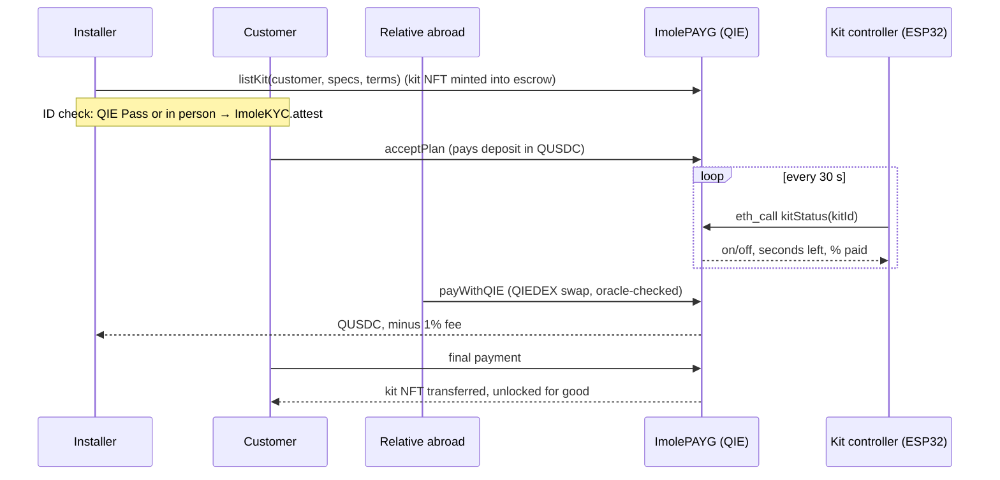

# Imole: pay-as-you-go solar on QIE

**The settlement and trust layer under any installer's pay-as-you-go solar business.**

Imole lets a solar installer sell home kits on credit without building their own payments, lock-out and credit stack. **Customers never need a crypto wallet:** they pay the installer or a local agent in cash or mobile money, as they already do, and the agent tops up the kit on-chain in one tap, like selling airtime. Each kit is an NFT on QIE Mainnet with a fixed price, and every payment buys days of power. The kit's controller switches the output off when the paid time runs out, either by reading the chain or, with no internet at the home, from a 12-digit code typed on its keypad. When the last payment lands, the NFT moves to the customer and the kit unlocks for good.

*Imole* means "light" in Yoruba. Nothing in the protocol is tied to one country: prices are in QUSDC, payments can come from any wallet in the world, and the controller only needs an internet connection.

Track: **Commerce & Real World**, QIE Hackathon 3.0 (Mainnet Edition).

| | |
|---|---|
| Live app | https://imole-ten.vercel.app |
| Demo video | `<link>` |
| ImolePAYG (QIE Mainnet) | [`0xae6501e9c96EaDFB835f11b581D8353cF5e7d8AD`](https://mainnet.qie.digital/address/0xae6501e9c96EaDFB835f11b581D8353cF5e7d8AD) |
| ImoleKYC (QIE Mainnet) | [`0x98CcF6f3680D6ddB1c1192Dffc70A63383Ae54D1`](https://mainnet.qie.digital/address/0x98CcF6f3680D6ddB1c1192Dffc70A63383Ae54D1) |
| Controller simulation | https://wokwi.com/projects/481132098048003073 |

## Judges: start here

| Path | Time | What you need | What you'll see |
|---|---|---|---|
| A. Watch | 3 min | Nothing | The demo video: an installer lists a kit, the customer accepts, a payment in QIE turns the controller on, time runs out and the relay drops, a relative pays from another wallet and power returns. |
| B. Check it, no wallet | 2 min | A browser | Open the live app's home page: the meter at the top is the demo kit, read live from mainnet. Then open the **Trust proofs** below: real mainnet transactions where the installer tries to cheat and the contract refuses. |
| C. Try it | 5 min | QIE Wallet with ~2 QIE | Open the demo kit's page and pay 1 QIE. The meter adds time within a few seconds, and the Wokwi controller turns on at its next poll. |
| D. Read the code | 10 min | GitHub | Start with [`contracts/src/ImolePAYG.sol`](contracts/src/ImolePAYG.sol), then the tests in [`contracts/test`](contracts/test). |

## Why this exists

About **720 million people** still had no electricity at all in 2025, according to the [IEA](https://www.iea.org/commentaries/a-record-number-of-people-in-africa-gained-electricity-access-in-2025). Most of them live in sub-Saharan Africa, with large pockets in South Asia, Haiti, and remote and island communities. Hundreds of millions more are on grids that fail for hours every day and fall back on diesel or petrol generators.

Pay-as-you-go solar, popularised by companies like M-KOPA and Sun King, is the proven fix: a household pays a deposit, then small regular amounts, and the kit locks itself when payments stop. It works, but only big companies with their own lock-out hardware, payment rails, local banking and credit teams can run it, and each one rebuilds that stack country by country.

Imole doesn't try to replace those companies or put crypto in front of their customers. It gives the thousands of small installers who can't build that stack the back end they're missing:

- **Customers pay the way they already do.** Cash or mobile money to an agent or the installer, who tops up from a QUSDC float on the [agent screen](https://imole-ten.vercel.app/#/agent). The chain is the installer's settlement layer, not the customer's app.
- **Works where there's no internet.** Like Sun King's and M-KOPA's keypad tokens, the controller accepts a 12-digit unlock code. Unlike theirs, a code can only cover time already paid on-chain, so nobody can sell power that wasn't paid for, and nobody can withhold power that was (the code endpoint is public).
- **The lock-out logic is a public contract**, not a proprietary server. Installers don't need to build one, and customers don't need to trust one.
- **Payments settle instantly in QUSDC** to the installer's wallet. No collections team, no 30-day settlement, no local bank integration per country.
- **Anyone can pay for anyone, across borders.** A relative working in another country can open the kit's link and buy a month of light for their family at home: no remittance fees, no FX desk.
- **Ownership is real.** The kit is an NFT, and the final payment transfers it to the customer automatically.

## Trust proofs (on mainnet)

These transactions were sent on purpose to show the contract refusing an installer who tries to cheat. Each one reverted on QIE Mainnet.

| What was tried | Result | Transaction |
|---|---|---|
| Installer repossesses a customer who is paid up | Reverted `NotOverdue` | [`0x372b…ffe5`](https://mainnet.qie.digital/tx/0x372bb75d522369afd955ea749eda368e3e3a69387e8c5cf979de3ec93059ffe5) |
| Installer cancels a plan after the customer accepted | Reverted `WrongStatus` | [`0x7622…7ee0`](https://mainnet.qie.digital/tx/0x76226c17e6e211505616e33a7ddd7cda66682efd450120e18377364f19447ee0) |
| Customer marks themselves as ID-verified | Reverted `NotAttester` | [`0xbcdf…0c4e`](https://mainnet.qie.digital/tx/0xbcdf015568cedfc12cfb845872033736becd1d7d63be5b94ce6727f46f580c4e) |

The same run also recorded the happy path: the customer [accepted the plan](https://mainnet.qie.digital/tx/0x2d2e6a0dc0805072f2c5df2d78532a68bdf7252e6437770bc5db7d3fa34db38d), then [paid 1 QIE](https://mainnet.qie.digital/tx/0x4640c6dcd8c8f9369cb4ce8eae05bcadbc5cfbeb3839f119fb3df3588bc7301e). QIEDEX swapped it to 0.1635 QUSDC, 99% went straight to the installer and 1% to the treasury, and the kit gained 32 minutes of power.

Run `contracts/script/demo.sh` (or `launch.command`) to produce these on your own deployment.

## How it uses QIE

| QIE component | How Imole uses it |
|---|---|
| **QIE Mainnet** (chain 1990) | Both contracts are deployed and source-verified here. The kit controller reads the chain directly over public RPC, with no Imole server in between. |
| **QUSDC** `0x3F43…5DA5` | The unit of every price and payment. Payments go straight from the payer to the installer (99%) and the Imole treasury (1%), never held by the contract. |
| **QIEDEX** router `0x08cd…53Ef` | `payWithQIE` swaps native QIE to QUSDC in the same transaction, so customers who only hold QIE can still pay. |
| **QIE Oracle** QIE/USD `0x3Bc6…3D17` | Every QIE payment is checked against the oracle price. If the swap returns more than 8% less than the oracle value, or the feed is more than 3 days old, the payment is refused. Both limits can be tuned by the owner (`setOracleGuard`). They're loose because the live QIE/USD feed swings 4–7% between rounds and has paused for over a day. This matters because the QIEDEX router's source isn't verified on the explorer. |
| **QIE Wallet** | Detected through EIP-6963 by `rdns: me.qiewallet`, with `window.qie` as the fallback, following QIE's integration guide. It is never identified by `isMetaMask`. |
| **QIE Pass** | Installers can require an ID check before a customer gets a kit on credit. `ImoleKYC` stores who verified the customer and a hash reference, never personal data. See "Status" below. |

## How it works



**Power state is computed from payments alone.** `isKitActive` returns true if the plan is paid off, or if `now <= paidUntil + grace`. Each payment adds `amount × period ÷ installment` seconds, counted from `paidUntil` if the customer is current, or from now if they had lapsed. Customers are never charged for days they were switched off: the kit simply takes longer to own.

**Rules the installer can't break:**

1. A customer who is paid up can't be switched off.
2. Price and terms are fixed when the customer accepts.
3. The kit can only be taken back after the customer is overdue by `repossessAfter` (30 days by default). Payments already made aren't refunded, as is standard in pay-as-you-go solar.
4. Once paid off, nobody can lock the kit again.

**The controller can't be gamed by going offline.** It counts the paid-up time down locally between reads. Unplugging the Wi-Fi keeps power on only for the time already paid for.

## Offline unlock codes

Off-grid homes often have no internet, so the controller can't always read the chain. Instead:

1. The customer pays (cash to an agent, or on-chain directly).
2. Anyone opens the kit's page or the agent screen and taps **Get code**. The service at `/api/code?kit=<n>` reads the kit's paid-up time from QIE Mainnet and returns a 12-digit code, which the agent reads out, writes down or sends by SMS.
3. The customer types it on the kit's keypad and presses `#`. The controller checks it offline and switches on until the paid-up time.

How a code works: it packs "powered until time T" (10-minute steps) with a 16-bit HMAC made with the kit's own device key. The controller only accepts a code that is newer than the one it holds, so old codes can't be replayed, and five wrong codes lock the keypad for ten minutes. Installers get each kit's device key from the Installers screen by signing a message with the wallet that listed the kit. The scheme is in [`web/api/_lib.ts`](web/api/_lib.ts) and mirrored in the firmware, with shared test vectors (`npx tsx web/scripts/test-codes.mts`, and the firmware's boot self-test).

Trust: the code service holds the key that derives device keys, so it's a trusted component, like the KYC attester. It can't move money, and it only issues codes for time the chain says is paid. The demo kit's device key is public in the Wokwi sketch so judges can try it; real kits get private keys.

## What Imole doesn't solve

Being honest about the hard parts of pay-as-you-go solar:

- **Hardware, logistics and field operations.** Sourcing kits, installing them, maintenance, customer support and physically recovering kits after a default all stay with the installer. Imole handles payments, lock-out rules and ownership, not trucks and technicians.
- **Physical tampering.** A determined owner can bypass any relay by rewiring, as with every pay-as-you-go system. The deterrents are the repossession right and losing the kit NFT, not the electronics.
- **Agent liquidity.** Agents need a QUSDC float. The agent screen can refill it in one tap by swapping QIE on QIEDEX, but turning collected cash into QIE or QUSDC, and back, still goes through an exchange or OTC desk. Mobile-money on- and off-ramps are the next integration and need a licensed partner.
- **Credit risk.** Imole enforces the terms an installer chooses; it doesn't decide who should get credit. An on-chain payment history is the start of a credit record, not a credit score.
- **Traction.** At submission this is one demo kit plus early pilots, not a network. The numbers on the home page are live and unedited.

## Repository

```
contracts/   Foundry project
  src/ImolePAYG.sol       kit NFT, plans, payments, QIEDEX + oracle path, on-chain art
  src/ImoleKYC.sol        ID-check attestations (QIE Pass or in person)
  src/KitArt.sol          on-chain SVG: lit sun when powered, grey when locked, gold ring when owned
  test/                   27 unit + fuzz tests, 4 invariant tests; mocks for QUSDC, oracle, router
  script/Deploy.s.sol     mainnet deploy
  script/preflight.sh     read-only checks of QUSDC, oracle and QIEDEX before deploying
  script/demo.sh          seeds the demo kit and sends the trust-proof transactions
web/         Vite + React + viem app (installer, agent, customer and family flows)
  api/code.ts             offline unlock code service (Vercel function, reads the chain)
  api/device-key.ts       gives an installer a kit's controller key after a signed check
firmware/    ESP32 controller sketch + Wokwi diagram
```

## Run it

### Contracts

```bash
./setup.sh            # first time only, if you got this as a zip: pulls forge-std and OpenZeppelin v5.0.2
# (if you cloned from GitHub instead: git submodule update --init --recursive)
cd contracts
forge test            # 27 tests
```

QIE Mainnet isn't at the Cancun fork: PUSH0 works, but MCOPY and TSTORE don't. `foundry.toml` pins `evm_version = "shanghai"`, OpenZeppelin is pinned to v5.0.2, and the non-transient `ReentrancyGuard` is used.

### Deploy to QIE Mainnet

```bash
cd contracts
./script/preflight.sh                                   # read-only: checks QUSDC decimals, oracle, QIEDEX quote
cast wallet import imole-deployer --interactive         # your key stays in an encrypted keystore
forge script script/Deploy.s.sol --rpc-url qie_mainnet --broadcast --account imole-deployer

# verify both contracts on the explorer (Blockscout)
forge verify-contract <KYC> src/ImoleKYC.sol:ImoleKYC --chain-id 1990 \
  --verifier blockscout --verifier-url https://mainnet.qie.digital/api/ \
  --constructor-args $(cast abi-encode "constructor(address)" <DEPLOYER>)
forge verify-contract <PAYG> src/ImolePAYG.sol:ImolePAYG --chain-id 1990 \
  --verifier blockscout --verifier-url https://mainnet.qie.digital/api/ \
  --constructor-args $(cast abi-encode "constructor(address,address,address,address,address,address)" \
    <DEPLOYER> <TREASURY> 0x3F43DA82eC9A4f5285F10FaF1F26EcA7319E5DA5 \
    0x3Bc617cF3A4Bb77003e4c556B87b13D556903D17 0x08cd2e72e156D8563B4351eb4065C262A9f553Ef <KYC>)

# seed the demo kit and record the trust proofs (needs a second wallet, imole-customer, with ~3 QIE)
cast wallet import imole-customer --interactive
PAYG=<PAYG> KYC=<KYC> ./script/demo.sh
```

### Web app

```bash
cd web
cp .env.example .env.local    # set VITE_PAYG, VITE_KYC, VITE_DEMO_KIT, VITE_REPO_URL
npm install
npm run dev
```

Deploy to Vercel as a static Vite site, with the same environment variables. The app uses hash routes, so no rewrites are needed.

### Controller (Wokwi, no hardware needed)

1. Open [wokwi.com](https://wokwi.com) and start a new ESP32 project.
2. Replace `sketch.ino` with [`firmware/imole-controller/imole-controller.ino`](firmware/imole-controller/imole-controller.ino), `diagram.json` with ours, and add the `LiquidCrystal I2C` and `Keypad` libraries (listed in `libraries.txt`).
3. Set `PAYG_ADDRESS`, `KIT_ID` and `DEVICE_KEY_HEX` at the top of the sketch, then press play.

The LCD shows the time left like a prepaid meter, the yellow "load" LED is the inverter output behind the relay, and the serial monitor logs every chain read. To see offline mode, slide the **Internet** switch off, get kit 1's code from the app, and type it on the keypad followed by `#`. On real hardware you need an ESP32 DevKit, a 5 V relay module, a 16×2 I2C LCD, a 4×4 keypad and two LEDs, and you set your own Wi-Fi.

## Business model

- **1% network fee** on every payment, to the Imole treasury. It's capped at 5% in the contract and can't be raised beyond that.
- Installers keep 99% and get paid the moment a customer pays.
- Agents earn the way airtime agents do: their own margin on the cash price they agree with the customer.
- **Planned:** verified-installer badges (registered businesses), kit insurance, and receivables financing. A portfolio of paying kits on-chain is a credit record that lenders can see.

## Status and honest limitations

- **Reviewed, not audited.** 27 unit and fuzz tests, 4 invariants under 61,440 random calls, and a Slither pass with every finding triaged: see [SECURITY.md](SECURITY.md). Don't put large amounts through it before a professional audit.
- **QIE Pass:** QIE Pass verification is a partner REST API with HMAC credentials, not an on-chain contract. `ImoleKYC` is built so a backend holding those credentials can attest customers as `Source.QiePass`. Until Imole receives partner credentials, attestations are done in person by the installer's field agent (`Source.InPerson`), which is also how most rural customers will be onboarded.
- **Attester trust:** whoever holds an attester key can mark customers as verified. The owner adds and removes attesters.
- **Controller:** the demo firmware skips TLS certificate pinning. The call is read-only, so the worst a network attacker can do is report "on" for a while. Production plan: pinned CA plus a status signed by a key that only the contract's owner controls. A determined owner can also bypass any relay by rewiring the kit, as with every pay-as-you-go system. The deterrent is the 30-day repossession right and the loss of the kit NFT.
- **QIEDEX router:** its source isn't verified on the explorer, so the contract doesn't trust its quote. The oracle floor protects every payment.

## Originality

Imole was written from scratch for QIE Hackathon 3.0. OpenZeppelin v5.0.2 and forge-std are used as attributed dependencies, and the seven-segment display font is DSEG (SIL Open Font License, see `web/public/fonts/DSEG-LICENSE.txt`). All application code in this repository is new.

## License

MIT
